<h3>Generative AI Engineer · Python · RAG · Agentic AI</h3>

  
  
  

  
  
  

---

## Profile

I build practical AI applications that connect **LLMs, retrieval systems, data, and backend services**. My current focus is on developing reliable LLM-powered workflows using Python, Retrieval-Augmented Generation (RAG), Agentic AI patterns, and API-based integrations.

I bring **one year of professional banking analytics experience** at Prevoyance IT Solutions, working on the ICICI Bank account, alongside hands-on project work in Generative AI and application development.

My approach combines analytical problem-solving with applied engineering: understand the problem, design the workflow, ground outputs in evidence, and make the system observable and testable.

## Areas of Focus

| Generative AI | Retrieval & Knowledge Systems | Application Engineering |
|---|---|---|
| LLM applications | RAG pipelines | Python |
| Agentic AI workflows | Vector search & embeddings | FastAPI & REST APIs |
| Prompt engineering | Query routing & rewriting | Pydantic & structured JSON |
| Tool calling | Evidence grading | API integration |
| LLM evaluation | Grounded responses & citations | Telemetry & monitoring |

## Featured Projects

### 01 · UrbanCart AI Shopping Assistant
**Multilingual RAG · Customer Support Automation · Working Prototype**

An AI shopping-support assistant designed to answer catalog and policy questions in English, Hindi, and Hinglish. The workflow combines intent routing, retrieval, tool calling, customer-aware order lookup, and human handoff.

- Built a RAG workflow over product catalog and policy data using ChromaDB.
- Implemented tool-based flows for stock, order status, alternatives, policy answers, and support tickets.
- Evaluated the system against a 300-query chat-log test set.
- Project evaluation reports handled-query coverage increasing from 44.0% to 60.3%; human tickets decreasing from 78 to 5.
- Includes a FastAPI endpoint and a Gradio interface; order operations are mocked.

**Stack:** Python · LangChain · ChromaDB · RAG · FastAPI · Gradio · Tool Calling

[View UrbanCart repository](https://github.com/Disha-pro/UrbanCart-AI-Shopping-Assistant)

---

### 02 · Video Compliance AI
**Multimodal Video Processing · LangGraph · Azure AI**

An AI-assisted video compliance auditing project that processes video content, extracts transcript and on-screen text, retrieves relevant compliance guidance, and prepares structured audit findings.

- Integrated YouTube video ingestion with Azure Video Indexer processing.
- Implemented a two-node LangGraph workflow for indexing and compliance auditing.
- Connected Azure OpenAI and Azure AI Search for LLM-based analysis and knowledge retrieval.
- Built FastAPI endpoints for audit submission, session identification, health checks, and structured responses.
- Added Azure Application Insights and OpenTelemetry instrumentation.

**Stack:** Python · FastAPI · LangGraph · LangChain · Azure Video Indexer · Azure OpenAI · Azure AI Search · OpenTelemetry

**Status:** Active development; end-to-end cloud deployment and complete audit flow remain under validation.

[View Video Compliance AI repository](https://github.com/Disha-pro/Video-Complaince-AI-)

---

### 03 · CortexRAG
**Adaptive Agentic RAG · Self-Correction · LLM Evaluation**

An Agentic RAG application that routes queries, grades retrieved evidence, retries weak retrieval through query rewriting, and uses web search when the private knowledge base is insufficient.

- Orchestrated retrieval and self-correction using LangGraph.
- Used Pinecone for vector retrieval and Tavily for web-search fallback.
- Added PDF text and table extraction with page-level metadata and citations.
- Implemented LLM-as-a-Judge evaluation for Faithfulness, Answer Relevance, Context Relevance, and Groundedness.
- Exposed execution paths and node-level traces through a Streamlit interface.

**Stack:** Python · LangGraph · LangChain · Pinecone · Groq · Hugging Face · Tavily · PyMuPDF · Streamlit

[View CortexRAG repository](https://github.com/Disha-pro/CortexRAG-Adaptive-Agentic-RAG-with-Self-Correction-Evaluation)

---

## Technical Toolkit

  
  
  
  
  
  
  
  
  
  
  
  

**GenAI & LLMs:** Generative AI, LLM applications, RAG, Agentic AI, prompt engineering, tool calling, structured outputs, multimodal processing.

**Retrieval & Evaluation:** Embeddings, semantic search, vector databases, query routing, query rewriting, evidence grading, LLM-as-a-Judge, groundedness, source citations.

**Cloud & Observability:** Azure OpenAI, Azure AI Search, Azure Video Indexer, Azure Application Insights, Azure Monitor, OpenTelemetry.

**Data & Analytics:** SQL, Pandas, Power BI, Power Query, Advanced Excel, data cleaning and analysis.

## Professional Experience

**Analyst — Prevoyance IT Solutions**  
*Client: ICICI Bank · February 2025 – January 2026*

- Analysed 20K+ monthly banking transactions using SQL to identify failure trends, operational exceptions, and response-code patterns.
- Developed Power BI dashboards to track transaction volumes, SLA compliance, and ageing metrics.
- Automated recurring reporting workflows using Power Query and Advanced Excel.

## Education

**B.Tech — Computer Technology Engineering**  
RTM Nagpur University · 2020–2024

**Generative AI & Agentic AI Program**  
Learnbay · 2026

## What I’m Looking For

Opportunities in **Generative AI Engineering, Junior AI Engineering, RAG Engineering, LLM Application Development, and Python AI Development**.

I’m interested in building useful AI systems, strengthening engineering practices, and contributing to teams taking LLM applications from prototypes toward reliable software.

---

### Let’s connect

<a href="mailto:dishaa.sonkar@gmail.com">dishaa.sonkar@gmail.com</a> ·
<a href="https://www.linkedin.com/in/dishasonkar">LinkedIn</a> ·
<a href="https://github.com/Disha-pro">GitHub</a>

Building with curiosity. Engineering with evidence.

